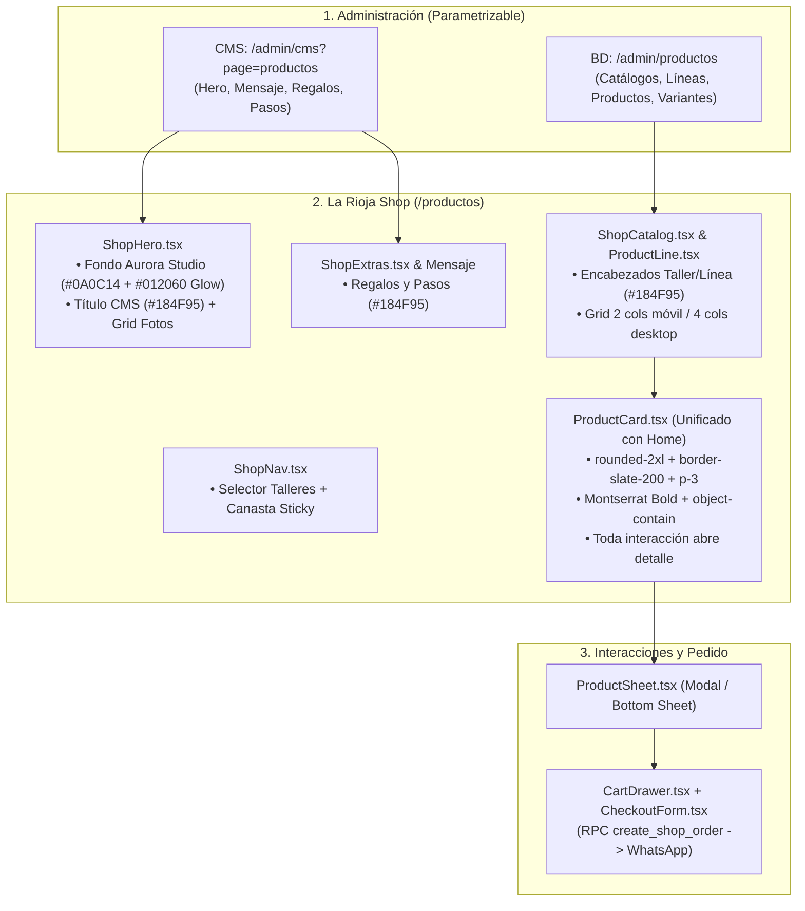

# Plan de Rediseño Integral: La Rioja Shop (`/productos`)

## Descripción del Objetivo

El objetivo de este plan es elevar la experiencia visual, funcionalidad, accesibilidad y consistencia de marca de la tienda pública de **La Rioja Shop** (`/productos`), cumpliendo con los estándares modernos de desarrollo web (**Modern Web Guidelines**, Core Web Vitals, WCAG AA) y la arquitectura de Next.js 16 (App Router + Turbopack) definida en el repositorio:

1. **Fondo de Hero con Efecto Aurora:** Sustituir el fondo plano `#174C6B` por el sistema de iluminación atmosférica **Aurora Background Studio** (preset *Azul La Rioja* `#012060` sobre lienzo `#0A0C14` con orbes difusos multinivel, `mix-blend-mode: screen` y `blur(140px)`).
2. **Identidad Cromática de Encabezados:** Aplicar el color de marca `#184F95` a los encabezados, títulos principales y acentos destacados de la tienda.
3. **Consistencia Visual con el Home:** Homogeneizar las tarjetas de producto de `/productos` (`ProductCard.tsx`) con el diseño contrastado de la sección *"Compra con propósito"* del Home (`FeaturedProducts.tsx`), incorporando contenedor `rounded-2xl`, borde `border-slate-200 dark:border-slate-800`, fondo `bg-white dark:bg-slate-900`, tipografía Montserrat y badges de acción.
4. **Parametrización Total CMS:** Preservar intacta y funcional la configuración desde `/admin/cms?page=productos` para las secciones `productos_hero`, `productos_mensaje`, `productos_regalos`, `productos_como_comprar` y `productos_paso_1..3`.
5. **Administración Dinámica desde Backoffice:** Mantener el desacoplamiento donde productos, catálogos, líneas, fotos, precios y pedidos se gestionan en tiempo real desde la sección *"Gestión Productos"* (`/admin/productos`).
6. **Rendimiento y Cero Re-render:** Preservar la regla de oro: las mutaciones (carrito, checkout WhatsApp vía RPC `create_shop_order`) no disparan re-render del árbol RSC ni `router.refresh()`.



---

## User Review Required

> [!IMPORTANT]
> **Paleta cromática del Hero:** Se aplicará el preset **Azul La Rioja** extraído del estudio de calibración (`base: #0A0C14`, `mainGlow: #012060`, `leftAura: #081738`, `rightAura: #0A1E4A`, `centerCore: #0B2568` con opacidad del 85% y desenfoque gaussiano de 140px). Los textos y fotos del CMS flotan por encima garantizando contraste accesible WCAG AA sobre fondo oscuro.

> [!NOTE]
> **Compatibilidad CMS y Admin:** Ninguna tabla de base de datos ni clave de CMS será modificada o renombrada. El código de la tienda pública leerá exactamente las mismas propiedades que actualmente se editan en el panel administrativo, asegurando retrocompatibilidad total.

---

## Decisiones Aprobadas por el Usuario

> [!TIP]
> 1. **Modo de Imagen (`object-contain`):** Las miniaturas de producto utilizarán `object-contain` limpio dentro de un contenedor neutral 1:1 (`bg-slate-50 dark:bg-slate-800`), garantizando que ninguna artesanía o producto sufra recortes.
> 2. **Flujo de Interacción Unificado:** Toda la tarjeta de producto actúa como disparador hacia la ficha de detalle (`ProductSheet` / modal o *bottom sheet*). Se retira el botón flotante aislado de compra rápida para asegurar que el cliente examine variantes, tamaños y detalles antes de agregar a la canasta.

---

## Proposed Changes

---

### Componente 1: Hero con Iluminación Aurora

#### [MODIFY] [`ShopHero.tsx`](file:///c:/Users/eesca/OneDrive/Proyecto%20Desarrollo/LaRioja-Bingo/LaRioja/src/components/products/ShopHero.tsx)
- Reemplazar la clase `bg-[#174C6B]` por un contenedor `relative overflow-hidden bg-[#0A0C14]`.
- Añadir la capa de resplandor ambiental (*Aurora Glow*) con los 4 orbes calibrados:
  - Orbe principal inferior (`#012060`, `blur(140px)`, `mix-blend-mode: screen`).
  - Auras laterales izquierda (`#081738`) y derecha (`#0A1E4A`).
  - Núcleo central suavizador (`#0B2568`, `blur(165px)`).
- Conservar los textos parametrizados del CMS (`badge`, `title`, `description`, `boton_1`, `boton_2`, `fotos`).

```tsx
// Estructura clave a implementar en ShopHero.tsx
<section id="contenido" className="relative overflow-hidden bg-[#0A0C14] text-white pt-8 lg:pt-14 pb-16 lg:pb-20">
  {/* Capa de iluminación Aurora (Gemini Studio - Azul La Rioja) */}
  <div className="pointer-events-none absolute inset-0 overflow-hidden opacity-85" aria-hidden="true">
    <div 
      className="aurora-glow-main absolute left-1/2 -translate-x-1/2 rounded-full"
      style={{
        bottom: "-120px",
        width: "1050px",
        height: "480px",
        backgroundColor: "#012060",
        filter: "blur(140px)",
        mixBlendMode: "screen",
      }}
    />
    <div 
      className="absolute top-[28%] -left-28 w-[520px] h-[520px] rounded-full"
      style={{
        backgroundColor: "#081738",
        filter: "blur(120px)",
        mixBlendMode: "screen",
      }}
    />
    <div 
      className="absolute top-[22%] -right-28 w-[560px] h-[560px] rounded-full"
      style={{
        backgroundColor: "#0A1E4A",
        filter: "blur(125px)",
        mixBlendMode: "screen",
      }}
    />
    <div 
      className="absolute top-1/2 left-1/2 -translate-x-1/2 -translate-y-1/2 rounded-full opacity-40"
      style={{
        width: "380px",
        height: "380px",
        backgroundColor: "#0B2568",
        filter: "blur(165px)",
      }}
    />
  </div>

  <div className="relative z-10 mx-auto max-w-[1200px] px-6 flex flex-col lg:flex-row lg:items-center gap-12">
    {/* Contenido CMS intacto */}
  </div>
</section>
```

---

### Componente 2: Tarjeta de Producto Unificada con el Home

#### [MODIFY] [`ProductCard.tsx`](file:///c:/Users/eesca/OneDrive/Proyecto%20Desarrollo/LaRioja-Bingo/LaRioja/src/components/shop/ProductCard.tsx)
- Rediseñar el contenedor principal para adoptar exactamente la morfología y elevación de `FeaturedProducts.tsx`:
  - `group flex flex-col justify-between overflow-hidden rounded-2xl border border-slate-200 bg-white p-3 shadow-xs transition-all duration-300 hover:-translate-y-0.5 hover:shadow-md dark:border-slate-800 dark:bg-slate-900 cursor-pointer`
- Contenedor de imagen 1:1 con `object-contain`:
  - `relative mb-2.5 aspect-square overflow-hidden rounded-xl bg-slate-50 dark:bg-slate-800 border border-slate-100 dark:border-slate-800/80 p-3`
  - Transición hover: `scale-105` suave al interactuar con la tarjeta.
- Título con tipografía Montserrat:
  - `font-montserrat text-xs sm:text-sm font-bold leading-snug text-slate-900 group-hover:text-[#184F95] dark:text-white dark:group-hover:text-larioja-amarillo`
- Separador y barra inferior:
  - `border-t border-slate-100 dark:border-slate-800 pt-2.5 mt-3 flex items-center justify-between`
  - Precio en `#184F95`: `font-montserrat text-xs sm:text-sm font-extrabold text-[#184F95] dark:text-larioja-amarillo`
  - Enlace visual: `Ver detalle →` (`text-xs font-bold text-sky-600 transition-all group-hover:translate-x-1`).
- Toda la tarjeta y sus elementos (`h3 button`, `div`, imagen) actúan de forma accesible abriendo `onOpen(product, trigger)`.

---

### Componente 3: Encabezados y Títulos Principales en `#184F95`

#### [MODIFY] [`ProductLine.tsx`](file:///c:/Users/eesca/OneDrive/Proyecto%20Desarrollo/LaRioja-Bingo/LaRioja/src/components/shop/ProductLine.tsx)
- Actualizar el título de la línea de producto a la tipografía y color estipulado:
  - De: `text-[var(--shop-text)]`
  - A: `font-montserrat text-lg sm:text-xl font-bold text-[#184F95] dark:text-sky-300`

#### [MODIFY] [`ShopExtras.tsx`](file:///c:/Users/eesca/OneDrive/Proyecto%20Desarrollo/LaRioja-Bingo/LaRioja/src/components/products/ShopExtras.tsx)
- `GiftsBanner`:
  - Botón de cotización: de `bg-[#174C6B]` a `bg-[#184F95] hover:bg-[#123E75] text-white`.
- `HowToBuy`:
  - Título principal: de `text-[#174C6B]` a `text-[#184F95] dark:text-white font-montserrat font-extrabold`.
  - Número de paso: de `bg-[#174C6B]` a `bg-[#184F95] text-white`.

#### [MODIFY] [`src/app/productos/page.tsx`](file:///c:/Users/eesca/OneDrive/Proyecto%20Desarrollo/LaRioja-Bingo/LaRioja/src/app/productos/page.tsx)
- Sección institucional (`productos_mensaje`):
  - Título principal: aplicar `text-[#184F95] dark:text-white font-montserrat font-extrabold`.

---

### Componente 4: Parametrización CMS y Gestión de Productos

- Se verifica que todos los campos del CMS se consumen de forma defensiva mediante `textOr` y `metaText`:
  - `productos_hero`: `badge`, `title`, `description`, `boton_1`, `boton_2`, `boton_1_enlace`, `boton_2_enlace`.
  - `productos_hero_foto_1..4`: Galería visual configurable.
  - `productos_mensaje`: `title`, `description`.
  - `productos_regalos`: `title`, `description`, `boton`, `etiqueta`, `mensaje_whatsapp`.
  - `productos_como_comprar` y `productos_paso_1..3`: Títulos y pasos descriptivos.
- Los productos, líneas y catálogos provienen directamente de la base de datos a través de `getPublicShop()`, de modo que cualquier cambio registrado en `/admin/productos` (título, precio, stock, orden o fotos) se refleja automáticamente en la tienda pública sin intervención de código.

---

## Verification Plan

### Automated Tests
1. **Verificación de Tipado TypeScript:**
   ```bash
   npx tsc --noEmit
   ```
2. **Auditoría Automatizada en Playwright (Escritorio y Móvil):**
   ```bash
   node audit-shop-runner.mjs
   ```
   - Validar que las tarjetas de producto en `/productos` cumplen con los estilos calculados (`border: 1px solid rgb(226, 232, 240)`, `borderRadius: 16px`, `font-bold`).
   - Validar que los encabezados principales contienen `#184F95` (`rgb(24, 79, 149)`).
   - Validar que el Hero tiene el fondo base `#0A0C14` y los orbes de desenfoque.
   - Validar que no hay desbordamiento horizontal en móvil (`375x667`).
   - Validar 0 errores en consola.

### Manual Verification
1. Abrir `http://localhost:3000/productos` en el navegador.
2. Comprobar visualmente la iluminación Aurora en el Hero y el contraste con las 4 fotos del CMS.
3. Observar la cuadrícula de productos: comprobar que cada tarjeta tiene su caja delimitada, sombra sutil, tipografía en negrita y precio en `#184F95`.
4. Hacer clic en una tarjeta y verificar la apertura fluida de la ficha modal / hoja inferior en móvil, probando el cierre con `Escape` y con el botón cerrar.
5. Agregar un producto a la canasta y verificar el proceso de checkout hacia WhatsApp.
